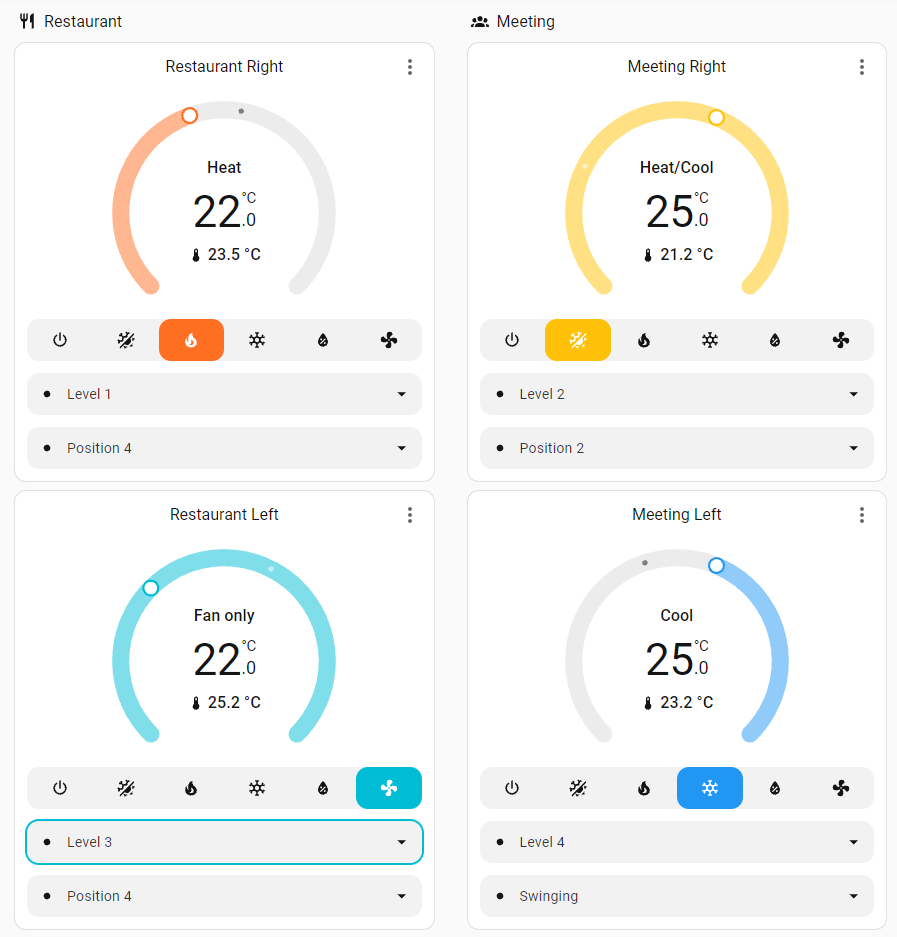
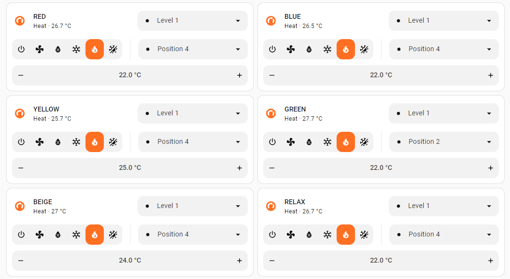
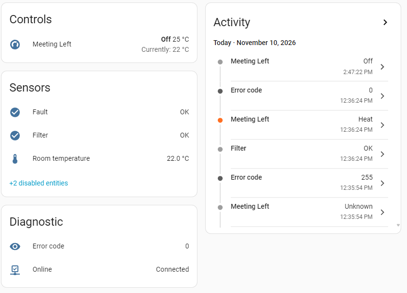
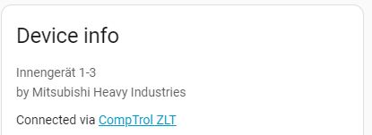
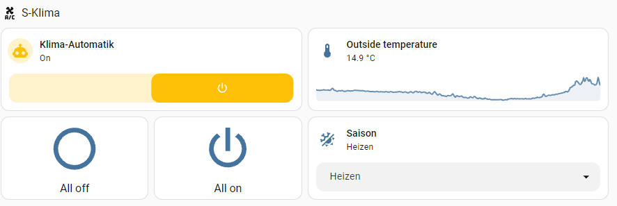
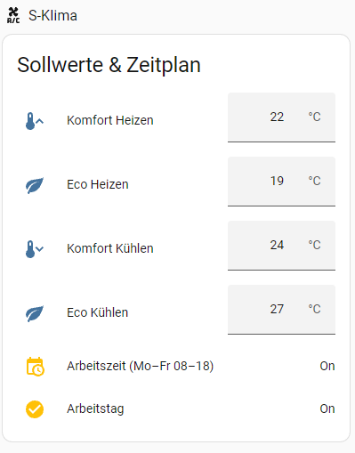
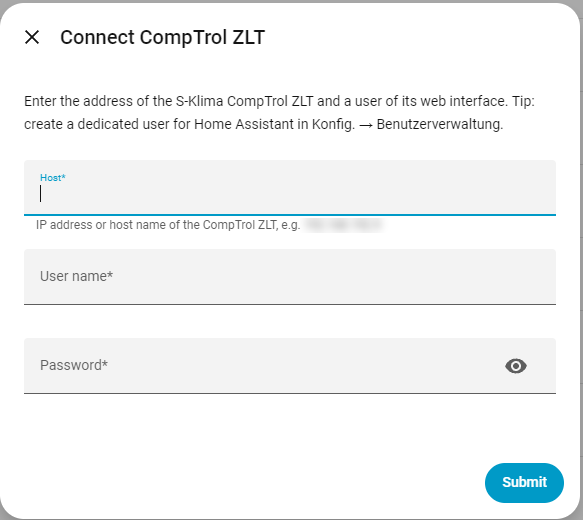
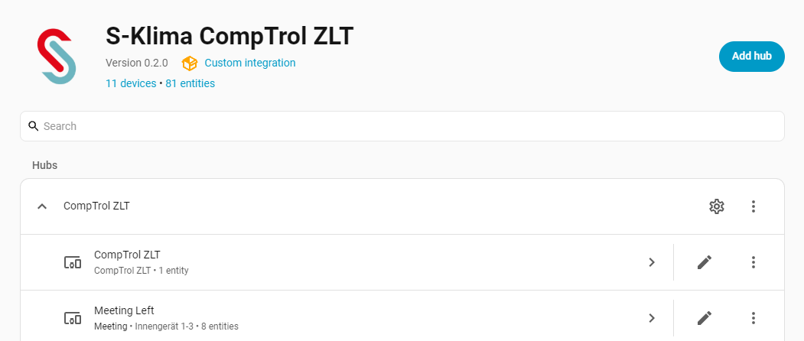
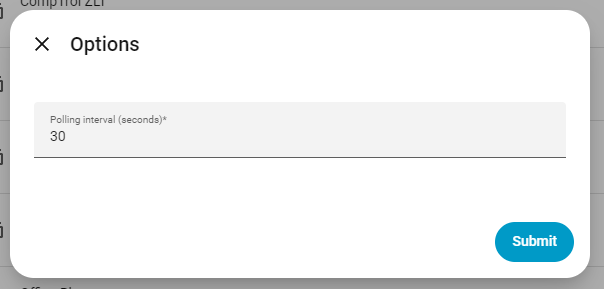

# S-Klima / STULZ CompTrol ZLT – Home Assistant integration (unofficial)

[](https://hacs.xyz/docs/faq/custom_repositories)
[](https://github.com/8871988-sketch/S-Klima-CompTrol-ZLT-Home-Assistant-Custom-Integration-UnOfficial/actions/workflows/validate.yml)


A custom integration for [Home Assistant](https://www.home-assistant.io/) that controls the air-conditioning indoor units connected to a **CompTrol ZLT** central controller (sold by **S-Klima / STULZ**, typically with Mitsubishi Heavy Industries VRF systems). It talks to the controller over your local network, using the same HTTP interface as the controller's own web UI. No cloud and no extra hardware are needed.

> [!IMPORTANT]
> This is a **community project**. It is **not** made, endorsed or supported by STULZ, S-Klima or Mitsubishi Heavy Industries. The protocol is not officially documented; a firmware update of the CompTrol ZLT may break the integration. Use at your own risk. All names are trademarks of their respective owners and are used only to describe compatible devices.

Deutsch: [siehe unten](#deutsch) · Українською: [див. нижче](#українською)

---

## Contents

- [Features](#features)
- [Screenshots](#screenshots)
- [Requirements](#requirements)
- [Installation](#installation)
- [Configuration](#configuration)
- [Entities](#entities)
- [Options](#options)
- [Glitch filter](#glitch-filter)
- [Examples](#examples)
- [Limitations](#limitations)
- [Troubleshooting](#troubleshooting)
- [Security](#security)
- [Protocol notes](#protocol-notes)
- [Development](#development)
- [License and disclaimer](#license-and-disclaimer)

## Features

- One Home Assistant **device per indoor unit**, found automatically
- **Climate** entity per unit: on/off, mode (auto, heat, cool, dry, fan), target temperature in 0.5 °C steps within the unit's limits, fan speed (auto, 1–4), louver (position 1–4, swing)
- Room temperature, error code, fault, filter alarm and online state per unit
- Optional power and energy sensors (for systems with energy meters)
- Outside temperature of the controller
- All units are read with **one request** per polling cycle (default every 30 s)
- Session handling: automatic re-login when the controller drops the session
- **Glitch filter** against short false alarms of the controller (see below)
- Respects locks set on the controller (a locked value cannot be changed from Home Assistant)
- Set up in the UI (config flow), re-authentication, options
- Translations: English, German, Ukrainian

## Screenshots

**Thermostat cards** – one climate entity per indoor unit with mode, set point, fan speed and louver:



**Compact tile cards** for many units:



**Device page** of an indoor unit – climate entity, sensors, diagnostics and history:





**Example of a dashboard built on top of the integration** with own helpers and automations (master switch, season, comfort/eco set points, working hours). These helpers and automations are *not* part of the integration – see [`examples`](examples) for a starting point:





## Requirements

| What | Details |
|---|---|
| Home Assistant | 2025.2 or newer |
| Controller | CompTrol ZLT with its web interface enabled (tested with firmware **5.003-074**) |
| Network | Home Assistant must reach the controller on **TCP port 80** (HTTP). If they are in different subnets/VLANs, allow this traffic in your router/firewall. |
| User | a user of the CompTrol web interface. A **dedicated user for Home Assistant** is recommended (*Konfig. → Benutzerverwaltung*), so Home Assistant does not log you out of the web UI. |

User name and password must not contain an apostrophe (`'`).

## Installation

### HACS (recommended)

1. Open **HACS** in Home Assistant.
2. Menu (⋮) → **Custom repositories**.
3. Repository: `https://github.com/8871988-sketch/S-Klima-CompTrol-ZLT-Home-Assistant-Custom-Integration-UnOfficial`, type: **Integration** → **Add**.
4. Search for **S-Klima CompTrol ZLT (unofficial)** and click **Download**.
5. **Restart** Home Assistant.

### Manual

1. Download the latest release (or the repository as ZIP).
2. Copy the folder `custom_components/s_klima` into the `custom_components` folder of your Home Assistant configuration, so that you end up with `/config/custom_components/s_klima/manifest.json`.
3. **Restart** Home Assistant.

## Configuration

1. **Settings → Devices & services → Add integration** → search for **S-Klima CompTrol ZLT**.
2. Fill in the form:

   


   | Field | Meaning |
   |---|---|
   | **Host** | IP address or host name of the CompTrol ZLT, e.g. `192.168.1.50` |
   | **User name** | user of the CompTrol web interface |
   | **Password** | password of this user |

3. The integration logs in, reads the list of indoor units and creates one device per unit plus one for the controller:

   

   Possible errors:

   | Error | Cause |
   |---|---|
   | *Cannot reach the CompTrol ZLT* | wrong address, controller off, or firewall/VLAN blocks port 80 |
   | *User name or password is wrong* | wrong credentials or the user is not active |
   | *must not contain an apostrophe* | change the password/user name |
   | *encrypted requests not supported* | RSA encryption is enabled on the controller (not supported yet) |
   | *no indoor units were found* | login worked, but the controller reports no units |

If the password changes later, Home Assistant asks for the new one (*Re-authentication required*).

## Entities

For each indoor unit (example name *Office*):

| Entity | Description |
|---|---|
| `climate.office` | on/off, HVAC mode, target temperature, fan speed, louver/swing. Attributes: address, error code, filter alarm, locks |
| `sensor.office_room_temperature` | room temperature |
| `sensor.office_error_code` | error code of the unit (diagnostic) |
| `binary_sensor.office_fault` | unit reports a fault |
| `binary_sensor.office_filter` | filter needs cleaning |
| `binary_sensor.office_online` | unit is reachable on the bus |
| `sensor.office_power`, `sensor.office_energy` | power and energy meter (disabled by default; useful only with energy meters) |

Controller device **CompTrol ZLT**:

| Entity | Description |
|---|---|
| `sensor.comptrol_zlt_outside_temperature` | outside temperature |

Mode mapping:

| CompTrol | Home Assistant |
|---|---|
| Auto | `heat_cool` (only if the unit supports it) |
| Heizen | `heat` |
| Kühlen | `cool` |
| Entfeuchten | `dry` |
| Lüften | `fan_only` |
| unit off | `off` |

## Options

**Settings → Devices & services → S-Klima CompTrol ZLT → Configure**



| Option | Default | Range |
|---|---|---|
| Polling interval | 30 s | 10–600 s |

## Glitch filter

The CompTrol ZLT sometimes returns a "no data" marker (`-2147483648`) for a unit for one poll, or reports a filter/fault/offline flag for a few seconds on all units at once. Without filtering this causes false notifications. Since version 0.2.0 the integration:

| Situation | Behaviour |
|---|---|
| a unit returns "no data" markers | the last good values are kept for up to 10 polls (5 min at 30 s) |
| a single field is invalid | the last known value of that field is kept |
| filter alarm changes | accepted after **10** polls in a row (5 min) |
| fault / online changes | accepted after **3** polls in a row (1.5 min) |
| the controller does not answer | the last state is kept for 3 polls, then entities become unavailable |

Every ignored glitch is written to the debug log together with the raw values.

## Examples

See the [`examples`](examples) folder:

- [`automations.yaml`](examples/automations.yaml) – fault/filter notification with debounce, window open → unit off, all units off in the evening
- [`dashboard_card.yaml`](examples/dashboard_card.yaml) – thermostat and status card

## Limitations

- Locks set on the controller (*Sperre*) for set point, mode, fan etc. are respected: Home Assistant shows an error and does not change the value.
- Schedules (*Schaltuhren*) and *Temp.-Automatik* on the controller can overwrite values set from Home Assistant.
- The login is sent over plain HTTP, exactly like the controller's own web UI. Keep the controller in a trusted network.
- RSA-encrypted requests are not supported yet.

## Troubleshooting

```yaml
# configuration.yaml
logger:
  default: warning
  logs:
    custom_components.s_klima: debug
```

Or temporarily: **Developer tools → Actions → `logger.set_level`** with `custom_components.s_klima: debug`.

When you open an issue, add the Home Assistant version, the integration version, the controller firmware and the log lines. **Remove passwords and IP addresses** before posting.

## Security

- Credentials are stored only in Home Assistant's configuration entry and are part of your backups – keep backups encrypted.
- Use a dedicated CompTrol user with only the rights Home Assistant needs.
- Do not expose the CompTrol web interface to the internet.

## Protocol notes

- `POST /web.dwh`, body `text/plain`: `mg=<session>&V=<expression>&...`
- Login: `##LOGIN('user', 'pass')` → session number; check: `##USERLEVELS()` (bit 2 = active user)
- Read all units: `G=##IndoorUnits.Count\t##IndoorUnits.Unit[##IndoorUnits.GetItemId[##X+0]].<Field>\t...`
- Write: `##IndoorUnits.Unit[1000].SetTemperature:=225` (temperatures in tenths of °C)
- Modes: 0 auto, 1 dry, 2 cool, 3 fan, 4 heat; fan 0 = auto, 1–4; louver 0–3 = position 1–4, 10 = swing
- Expired session → error `-104`, the integration logs in again

File overview:

| File | Purpose |
|---|---|
| `api.py` | HTTP client and parser for the CompTrol protocol, no Home Assistant code |
| `stabilize.py` | glitch filter |
| `coordinator.py` | polling, retries, writes |
| `config_flow.py` | setup form, re-authentication, options |
| `climate.py`, `sensor.py`, `binary_sensor.py` | entities |

## Development

```bash
python -m venv .venv && . .venv/bin/activate
pip install -r requirements_test.txt
pytest -q
```

The tests use an emulator of the controller (`tests/fake_zlt.py`) and a recorded response (`tests/data/live_poll_response.txt`); no real device is needed.

## License and disclaimer

[MIT](LICENSE). The software is provided "as is", without warranty of any kind. Changing settings of an air-conditioning system can have consequences (comfort, energy cost, equipment); you are responsible for how you use it.

Not affiliated with, authorised, maintained, sponsored or endorsed by STULZ GmbH, S-Klima or Mitsubishi Heavy Industries. All product and company names are trademarks or registered trademarks of their respective holders; they are used only to identify compatible devices.

---

## Deutsch

Inoffizielle Home-Assistant-Integration für die **CompTrol ZLT** (S-Klima / STULZ) – steuert die angeschlossenen Innengeräte lokal über dieselbe HTTP-Schnittstelle wie die Weboberfläche. Kein offizielles Produkt von STULZ / S-Klima.

**Installation:** HACS → ⋮ → *Benutzerdefinierte Repositories* → diese Repository-URL, Typ *Integration* → herunterladen → neu starten. Alternativ `custom_components/s_klima` nach `/config/custom_components/` kopieren.

**Einrichtung:** *Einstellungen → Geräte & Dienste → Integration hinzufügen → S-Klima CompTrol ZLT*, Host, Benutzer und Passwort der Weboberfläche eingeben. Empfehlung: eigenen Benutzer für Home Assistant anlegen (*Konfig. → Benutzerverwaltung*). Home Assistant muss die ZLT über TCP 80 erreichen.

**Entitäten pro Innengerät:** Klima (Ein/Aus, Modus, Sollwert, Lüfter, Lamellen), Raumtemperatur, Fehlercode, Störung, Filter, Online, optional Leistung/Energie. Dazu die Außentemperatur der ZLT. Kurze Fehlmeldungen der ZLT werden herausgefiltert (siehe [Glitch filter](#glitch-filter)).

## Українською

Неофіційна інтеграція Home Assistant для центрального контролера **CompTrol ZLT** (S-Klima / STULZ): керує внутрішніми блоками кондиціонерів локально, через той самий HTTP-інтерфейс, що й веб-інтерфейс. Не є офіційним продуктом STULZ / S-Klima.

**Встановлення:** HACS → ⋮ → *Custom repositories* → URL цього репозиторію, тип *Integration* → завантажити → перезапустити. Або скопіювати `custom_components/s_klima` у `/config/custom_components/`.

**Налаштування:** *Налаштування → Пристрої та служби → Додати інтеграцію → S-Klima CompTrol ZLT*, ввести адресу, користувача й пароль веб-інтерфейсу. Радимо окремого користувача для Home Assistant (*Konfig. → Benutzerverwaltung*). Home Assistant має бачити контролер по TCP 80.

**Сутності для кожного блоку:** клімат (увімк./вимк., режим, уставка, вентилятор, жалюзі), температура в приміщенні, код помилки, несправність, фільтр, на зв'язку, за бажання потужність/енергія. Плюс зовнішня температура контролера. Короткі хибні тривоги контролера відфільтровуються (див. [Glitch filter](#glitch-filter)).
